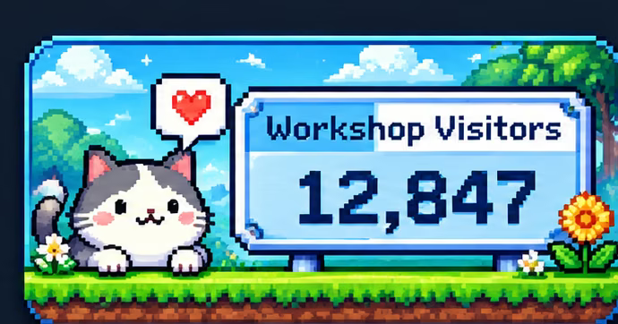
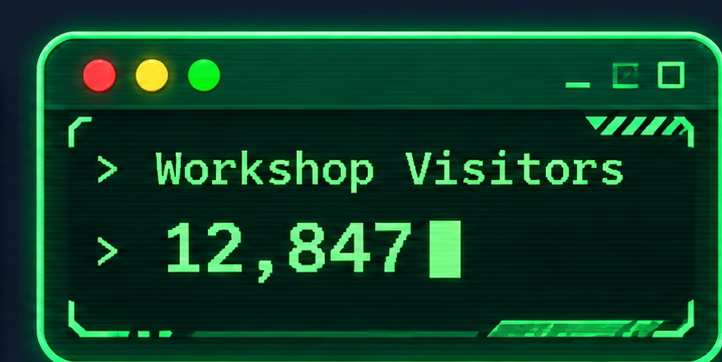

# GitHub README image-proxy compatibility probes

**PR-only visual diagnostics. Not a release, deployment, or real visitor counter.**

This page intentionally uses the **same embedded AVIF image payload and SVG nesting/crop geometry** as the three owner-approved styles to check whether GitHub renders these files as Markdown images. All three are fixed at the example number **12,847**. Neither this page nor these static samples can access Cloudflare, D1, admin credentials or visit accounting.

## 1. Pixel cat

## 3. Green terminal

## 5. Blue-gold RPG

## Interpreting results

- The GitHub-rendered page must show all three full images, not broken placeholders, truncated panels or blank art.
- If GitHub serves the SVG file directly but its Markdown preview is broken, **GitHub image-proxy compatibility is not established**. A local Chrome test cannot override that outcome.
- This only probes **static GitHub-hosted SVG**, not a remote Cloudflare Worker response or its headers, changing D1 counts, actual cache behavior, or separate-account billing. Those are still release gates in Issue #22.
- The referenced raster was embedded as AVIF during earlier development. These probes do not claim lossless pixel identity or that dynamically drawn numerals are exact copies of the demo number.
- Do not copy these sample image links to a profile README for live visits. They are static diagnostic files and will never increment a counter.

[Source development PR #21](https://github.com/guitar0788/workshop-Visitor-Terminal/pull/21) · [Independent self-host release gate #22](https://github.com/guitar0788/workshop-Visitor-Terminal/issues/22)
